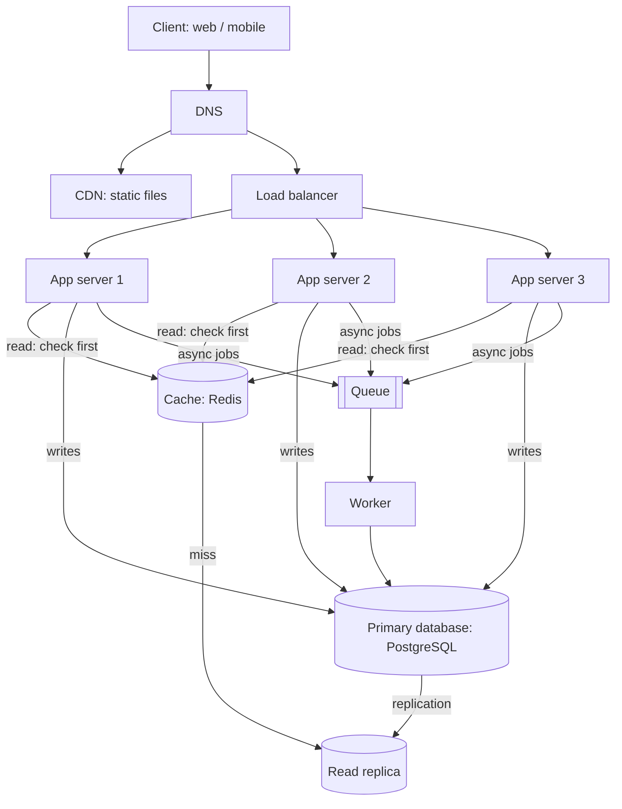

# QuickNotes Architecture

How QuickNotes moves from a browser-only app to an online service for **1 million users**. API details are in [api-design.md](api-design.md) and the database in [data-model.md](data-model.md).

## 1. Requirements

### Functional

- Users can register, log in and log out.
- Users can create, view, edit and delete their own notes.
- Users can tag notes and filter or search their notes.
- Notes sync across devices: a note created on a phone appears on a laptop.
- Users can only access their own data.

### Non-functional

| Quality | Target |
|---------|--------|
| Availability | 99.9% (about 8.8 hours of downtime a year at most); no single point of failure |
| Latency | p95 under 300 ms for reads, under 500 ms for writes |
| Scalability | Handle 1 million registered users, and grow 10x by adding servers, not by rewriting |
| Durability | Never lose a saved note: replicated storage plus daily backups and point-in-time recovery |
| Consistency | A user sees their own writes immediately (read-your-writes); other replicas may lag by a second or two |
| Security | HTTPS everywhere, hashed passwords, token auth, rate limiting, per-user data isolation |

## 2. Load estimate (1 million users)

**Assumptions** (stated so they can be challenged and changed):

- 1,000,000 registered users, 20% active on a given day = **200,000 daily active users (DAU)**
- Each active user makes about **20 reads** a day (opening the app, listing, viewing notes)
- Each active user makes about **4 writes** a day (creating, editing, deleting), of which about 2 are new notes
- Peak traffic is about **5x** the daily average
- Average note (title, body, tags, row and index overhead) is about **2 KB**

| Metric | Calculation | Result |
|--------|-------------|--------|
| Reads per day | 200,000 x 20 | 4,000,000 |
| **Reads per second (average)** | 4,000,000 / 86,400 | **about 46 /s** |
| Reads per second (peak) | 46 x 5 | about 230 /s |
| Writes per day | 200,000 x 4 | 800,000 |
| **Writes per second (average)** | 800,000 / 86,400 | **about 9 /s** |
| Writes per second (peak) | 9 x 5 | about 46 /s |
| New notes per year | 200,000 x 2 x 365 | about 146 million |
| **Storage per year** | 146,000,000 x 2 KB | **about 0.3 TB** (about 0.6 TB with indexes) |

**What this tells us:** the read-to-write ratio is about 5:1, so the design favors read scaling (cache and read replicas). The load is modest: one well-tuned database can handle it, so we add redundancy mainly for **availability**, and we keep a clear path to scale (caching, replicas, later sharding by `user_id`) rather than building for a load we do not have yet.

## 3. Architecture diagram

```
                              ┌──────────┐
                              │  Client  │  (web app / mobile app)
                              └────┬─────┘
                                   │ 1. resolve api.quicknotes.example
                                   ▼
                              ┌──────────┐
                              │   DNS    │
                              └────┬─────┘
                                   │
              static files (JS/CSS/images)       API requests (HTTPS)
                   ┌───────────────┴───────────────┐
                   ▼                               ▼
              ┌──────────┐                  ┌───────────────┐
              │   CDN    │                  │ Load balancer │  (health checks,
              └──────────┘                  └───────┬───────┘   standby pair)
                                      ┌─────────────┼─────────────┐
                                      ▼             ▼             ▼
                                ┌──────────┐  ┌──────────┐  ┌──────────┐
                                │  App     │  │  App     │  │  App     │
                                │ server 1 │  │ server 2 │  │ server 3 │  (stateless)
                                └──┬───┬───┘  └──┬───┬───┘  └──┬───┬───┘
                                   │   │         │   │         │   │
              ┌────────────────────┘   │         │   │         │   └──────────────┐
              │ reads: check first     │         │   │         │                  │ async jobs
              ▼                        │         │   │         │                  ▼
        ┌───────────┐                  │ writes  │   │         │            ┌───────────┐
        │   Cache   │                  │         │   │         │            │   Queue   │
        │  (Redis)  │                  ▼         ▼   ▼         ▼            └─────┬─────┘
        └─────┬─────┘             ┌───────────────────────┐                       │
              │ miss              │   Primary database    │                       ▼
              ▼                   │     (PostgreSQL)      │                 ┌───────────┐
        ┌───────────────┐         └───────────┬───────────┘                 │  Worker   │
        │ Read replica  │◄────────────────────┘ replication                 │ (email,   │
        │ (PostgreSQL)  │                                                   │ search    │
        └───────────────┘                                                   │ indexing, │
                                                                            │ cleanup)  │
                                                                            └───────────┘
```

The same picture as a Mermaid diagram (renders on GitHub):



## 4. Components: the problem each one solves

- **Client:** gives users the interface and talks to the API over HTTPS using the contract in `api-design.md`.
- **DNS:** turns the readable name `api.quicknotes.example` into the address of the load balancer, and lets us move or add infrastructure without users changing anything.
- **CDN:** serves static files (HTML, CSS, JS, images) from servers near the user, so pages load fast (important with Kenyan mobile latency) and our app servers do not spend capacity on static files.
- **Load balancer:** spreads requests across the app servers and removes unhealthy servers from rotation, so no single server is overloaded and one crash does not take the service down.
- **App servers (two or more, stateless):** run the API logic (validation, auth, business rules); because they keep no session data locally, we can add or remove servers freely and any server can handle any request.
- **Cache (Redis):** keeps hot results (a user's recent notes list, session/token data) in memory so repeated reads return in about a millisecond and the database is protected from the 5:1 read load.
- **Primary database (PostgreSQL):** is the single source of truth and the only place writes go, which keeps data consistent and durable.
- **Read replica:** holds a continuously updated copy of the primary that serves cache-miss reads and analytics queries, taking read load off the primary and acting as a ready standby if the primary fails.
- **Queue:** accepts slow or non-urgent jobs from the app servers instantly, so a user's request is not kept waiting and traffic spikes are smoothed out.
- **Worker:** pulls jobs from the queue and does them in the background (welcome and password-reset emails, updating the search index, cleaning up deleted data, generating exports), with retries if a job fails.

## 5. Request flows

### GET /notes (read path)

1. The client sends `GET /v1/notes?limit=20` with its access token over HTTPS. DNS has already resolved the hostname.
2. The **load balancer** picks a healthy app server (for example, round-robin).
3. The **app server** validates the token and extracts the `user_id`. Invalid or expired: return `401`.
4. It builds the cache key, for example `notes:{user_id}:first_page`, and asks the **cache**.
5. **Cache hit:** return the cached JSON immediately (`200 OK`). Done.
6. **Cache miss:** run the list query against the **read replica** (using the index on `(user_id, created_at DESC)`).
7. The app server stores the result in the cache with a short TTL (for example 60 seconds).
8. It returns `200 OK` with the notes and `next_cursor` through the load balancer to the client.

### POST /notes (write path)

1. The client sends `POST /v1/notes` with the JSON body and token.
2. The **load balancer** forwards it to a healthy app server.
3. The **app server** validates the token, then the body (title required, max 100 characters). Invalid: return `400` or `422`.
4. It writes the note and its tag links to the **primary database** in one transaction.
5. On success, it **invalidates** the user's cached list (`DEL notes:{user_id}:*`), so the next read does not show stale data and the user sees their own write.
6. It puts a job on the **queue** (for example `index_note`) and returns immediately; it does not wait for the job.
7. The server returns `201 Created` with the new note and a `Location` header.
8. A **worker** picks up the job and updates the search index in the background. If it fails, the queue retries it, and the user is never affected.

## 6. Trade-offs

1. **Caching: speed vs freshness.** The cache makes reads fast and cheap, but cached data can be stale. We accept a short TTL (60 s) and explicitly invalidate on writes, so a user always sees their own changes while other readers may briefly see older data. For notes this is acceptable; for something like payments it would not be.
2. **Read replicas: scale vs consistency.** Replication is asynchronous, so a replica can be a second or two behind the primary. We gain read capacity and a failover target, but a read right after a write could miss the new note if it hit the replica. We handle this by invalidating the cache on write and, for a short window after a write, routing that user's reads to the primary (read-your-writes).
3. **Queue and worker: responsiveness vs immediacy.** Doing indexing and emails asynchronously keeps API responses fast and absorbs spikes, but those effects are not instant (search may lag by a few seconds) and the system gets more moving parts to monitor. We chose it because users notice slow saves far more than a slightly delayed search result.
4. **SQL on a single primary: simplicity vs write scaling.** One primary keeps transactions and consistency simple, but all writes go to one machine. At about 46 writes per second at peak this is comfortable by a wide margin; if growth demands it, we can partition or shard by `user_id` later. Starting simple is cheaper and easier to operate.
5. **Stateless app servers: flexibility vs a little overhead.** Keeping sessions in tokens and Redis (not in server memory) means every request carries a token to verify, but any server can serve any user and servers can be replaced at will.

## 7. Single points of failure and how we avoid them

| Component | Risk | How it is avoided |
|-----------|------|-------------------|
| DNS | Provider outage | Use a managed DNS provider with multiple name servers; low TTL so we can repoint quickly |
| CDN | Edge location fails | The CDN is a distributed network; requests automatically use another edge. Static files can also fall back to the origin |
| Load balancer | LB crashes | Run an active-passive (or active-active) **pair** with a shared virtual IP or a managed multi-zone load balancer |
| App servers | A server crashes | Run **two or more** across different availability zones; the load balancer's health checks stop sending traffic to a failed one; auto-scaling replaces it |
| Cache | Redis node dies | Redis with a replica and automatic failover. If the cache is down entirely, the app falls back to the database (slower, but still working), so the cache is an optimization, not a dependency |
| Primary database | Primary dies | The **read replica** is promoted to primary (automatic failover, usually under a minute); continuous WAL archiving and daily backups allow point-in-time recovery |
| Read replica | Replica dies | Reads fall back to the primary (with a lower load limit) while a new replica is created; more than one replica can be added |
| Queue | Broker fails | Use a managed, replicated queue with persistent messages; the app can still save notes and retry enqueueing if the queue is unavailable |
| Worker | Worker crashes mid-job | Jobs are acknowledged only when finished, so an unfinished job is redelivered; run several workers so another picks it up |
| Whole data center | Region/zone outage | Spread servers and the database replica across at least two availability zones; keep backups in a separate location |

The key principle: **every layer has at least two instances**, nothing important is stored on a single app server, and the system degrades gracefully (slower, not down) when an optional part like the cache or queue fails.